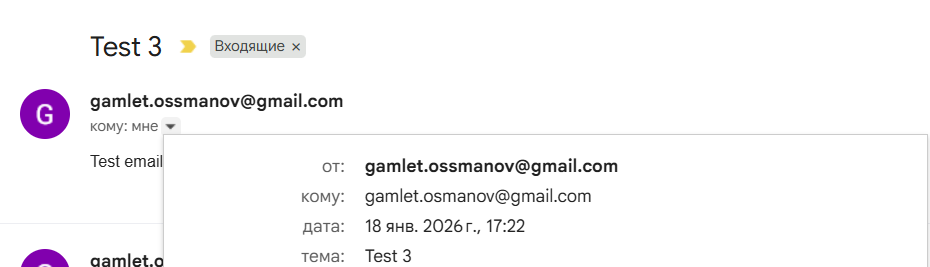
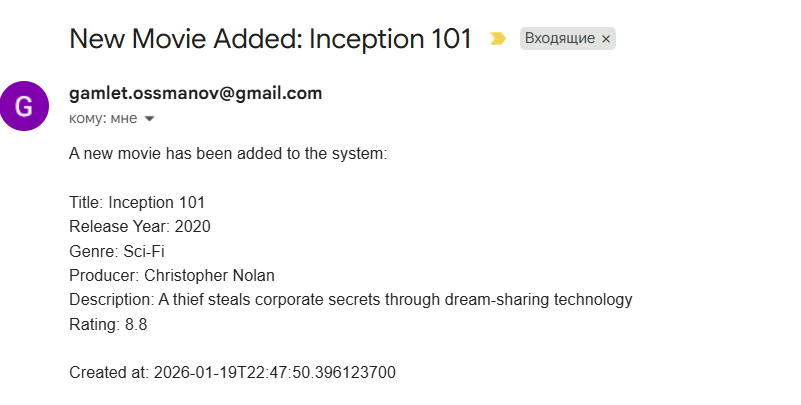

Client
↓
Backend Service (Spring Boot)
↓
PostgreSQL

Backend Service
↓
Email Service
↓
Gmail SMTP
## Build and Run

### 1. Build the Services

Before starting the containers, build the executable JAR files for both services.

#### Email Service (Gradle)

Navigate to the `email-service` directory and run:

```bash
./gradlew clean build
```

#### Backend Service (Maven)

Navigate to the `Spring Boot and REST API` directory and run:

```bash
mvn clean package
```

**Tip:** You can also use the built-in Maven and Gradle tools in IntelliJ IDEA.

---

### 2. Configure Gmail SMTP

To enable email delivery:

1. Enable Two-Factor Authentication for your Google account.
2. Open **Google App Passwords**.
3. Generate a new application password (for example, "Java App").
4. Replace the following values in the configuration files:

* Sender email address
* Recipient email address
* Gmail App Password

Use the generated password in your environment variables or `.env` file.

---

### 3. Start the Infrastructure

Launch all required services from the project root directory:

```bash
docker-compose up -d
```

You can also start services manually.

Example for Elasticsearch:

```bash
docker run -d \
  --name elasticsearch \
  -p 9200:9200 \
  -p 9300:9300 \
  -e "discovery.type=single-node" \
  -e "xpack.security.enabled=false" \
  elasticsearch:8.17.10
```

---

## API Usage and Testing

### Send an Email

Request:

```http
POST http://localhost:8081/api/emails/send
```

```json
{
  "ownerRef": "Hamlet",
  "emailFrom": "sender@gmail.com",
  "emailTo": "recipient@gmail.com",
  "subject": "Test Email",
  "text": "Hello from Email Service"
}
```

After executing the request, an email will be delivered to the specified recipient.



---

### Create a Producer

```http
POST http://localhost:8080/api/producers
```

```json
{
  "name": "Wigram",
  "country": "UK"
}
```

---

### Create a Movie

```http
POST http://localhost:8080/api/movies
```

```json
{
  "title": "Sherlock Holmes 2",
  "releaseDate": 2011,
  "producerId": 1,
  "genre": "Sci-Fi",
  "description": "Sherlock Holmes and his sidekick Dr. Watson join forces to outwit and bring down their fiercest adversary, Professor Moriarty",
  "rating": 7.4
}
```

When a new movie is created, the system automatically sends a notification email to the administrator.



---

## Swagger Documentation

Swagger UI is available at:

```text
http://localhost:8080/swagger-ui/index.html
```

Use it to test and explore the REST API.

---

## Database Configuration

Default PostgreSQL configuration:

```properties
spring.datasource.url=jdbc:postgresql://localhost:5432/movies_db
spring.datasource.username=postgres
spring.datasource.password=hamletnadirian
```

For more details about the backend service implementation, see:

https://github.com/HamletNadirian/AdvancedJavaBackend/tree/master/Spring%20Boot%20and%20REST%20API
